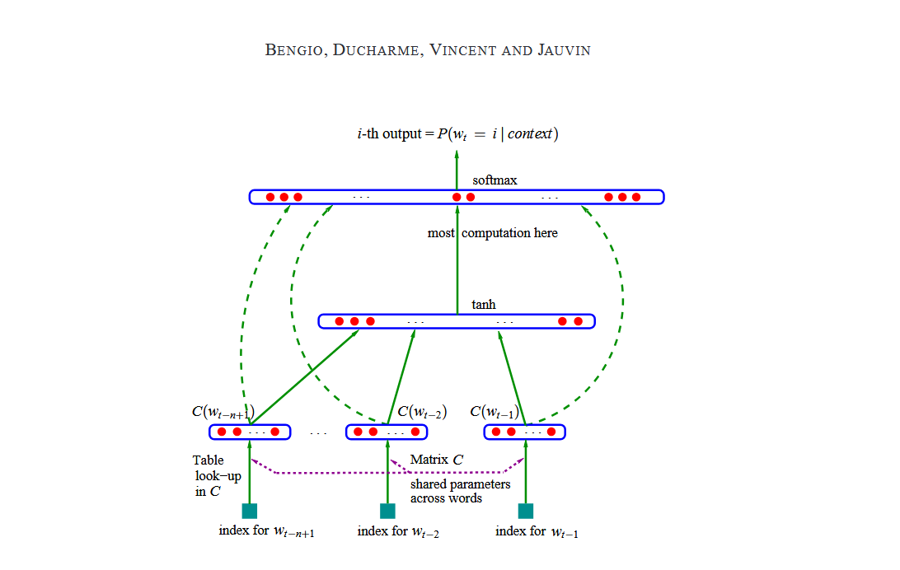
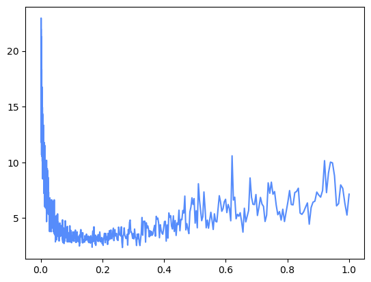
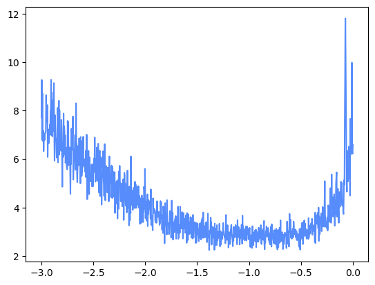
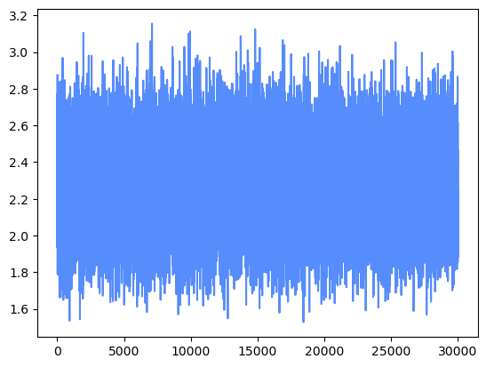
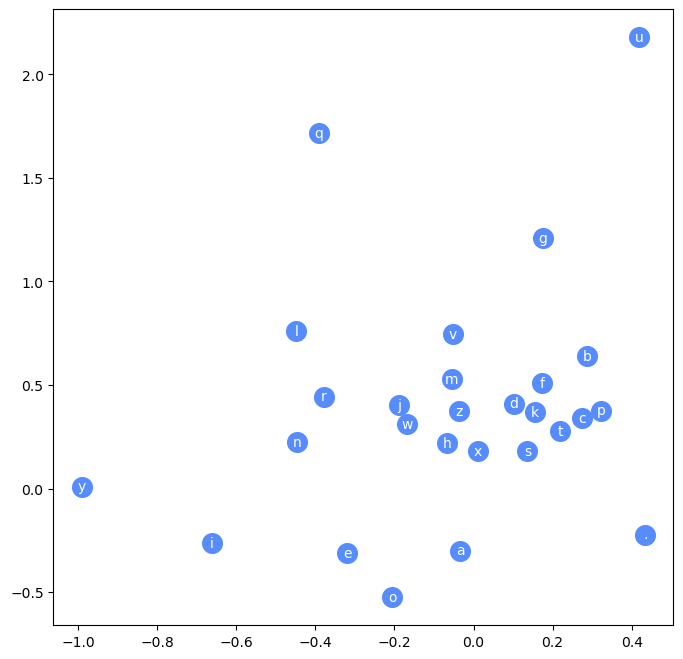

# P3

## 3.1 介绍



这里的：

$$
w_{t-n+1},\quad w_{t-2},\quad w_{t-1}
$$

分别表示输入自发序列的第一个、倒数第二个、最后一个字符，我们需要输入对应的索引。

C是一个矩阵，存储着每个字符对应的向量，所有字符公用一个矩阵。

根据索引从中取出对应的向量，假设我们输入三个字符，e、m、m，它们的对应向量为C(e)=[0.2,0.8]、C(m)=[0.5,-0.3] 、C(m)=[0.5,-0.3] 。

下一步将它们拼接成为一个向量， x=[0.2,0.8,0.5,-0.3,0.5,-0.3]，经过线性变换和激活函数：

$$
z=xW_1+b_1
$$

$$
\boxed{h=\tanh(xW_1+b_1)}
$$

假设输出为：

$$
h=[0.3,0.6,-0.2,\ldots]
$$

还要再经过一个输出层：

$$
logits=hW_2+b_2
$$

由于我们希望预测的是下一个字符，所以输出为27维向量（26个字符，1个结束符）。

接下来通过Softmax：

$$
P_i=\frac{e^{logits_i}}{\sum_{j=1}^{27}e^{logits_j}}
$$

得到最终的结果。假设输出为：[0.7，0.2，……]。下一个字符最有可能为a。

**Embedding（嵌入）本质上就是：将一个字符、单词等离散对象，转换成一个可以通过训练学习的数值向量。**

原论文研究的是单词级模型，因此是给每一个单词编号。而bigram是字符级模型，是给每一个字符编号。

## 3.2 构建数据集

```
import torch
import torch.nn.functional as F
import  matplotlib.pyplot as plt
%matplotlib inline
words = open('names.txt','r').read().splitlines()
chars = sorted(list(set(''.join(words))))
stoi = {s: i+1 for i, s in enumerate(chars)}
stoi['.'] = 0
itos = {i:s for s, i in stoi.items()}
```

```
### 构建数据集，X表示上下文标签，Y表示期待结果的标签
block_size = 3
X, Y = [], []
for w in words:
    print(w)
    context = [0] * block_size
    for ch in w + '.':
        ix = stoi[ch]
        X.append(context)#[[0,0,0]]
        Y.append(ix)#[5]
        print(''.join(itos[i] for i in context), '--->', itos[ix])#...--->e
        context = context[1:] + [ix]#[0,0,5]
X = torch.tensor(X)
Y = torch.tensor(Y)
```

普通参数（Parameter）是模型自己通过训练学出来的；超参数（Hyperparameter）是人提前设定，用来控制模型如何学习的。

## 3.3 嵌入查找表C(输入层)

C为字符嵌入矩阵（Embedding Matrix），也称为嵌入查找表（Embedding Lookup Table）。矩阵的每一行对应一个字符的嵌入向量，每一列对应嵌入向量的一个特征维度。C是可学习参数，在模型训练过程中不断更新。

```
C = torch.randn((27,2))
```

对于该模型，预测的有26个字母+起始结束符.共27个字符，因此C表有27行，对应27个字符，有两列，表示27个字符会被映射到一个二维空间。**例如`C[5]`，表示e对应的二维向量。**

```
F.one_hot(torch.tensor(5), num_classes=27).float() @ C
```

在P2中，我们学习了利用独热编码生成对应的多维向量。例如`F.one_hot(torch.tensor(5), num_classes=27)`会生成[0,0,0,0,0,1,……]的27维向量。如果该向量与矩阵C做矩阵乘法，会得到什么？

答案是直接得到e对应表C中的二维向量，实际上可以将这一层看作输入层，输入为每一个字符的独热编码，权重为C，输出为对应的嵌入表示。没有偏置也没有激活函数。

**X表示输入字符的数字编号张量，由于设置的`block_size = 3`，因此模型根据输入的三个字符，预测下一个可能的输出。**

如果只取数据集的前五个姓名，会得到32个输入上下文，每个上下文包括3个数字编号，此时X的形状为32\*3。

C一次只能得到一个字符的嵌入向量，X一次只能得到一个字符的数字编号。

我们希望得到一张**表格**emb，能够直接提取上下文对应的嵌入向量，也就是一次得到输入三个字符的嵌入向量。

令`emb = C[X]`会形成一个形状为32\*3\*2的张量，C[X]将X中的每一个整数直接替换成对应的C[index]。

```
X[13,2]、C[X][13,2]、C[1]
```

X[13, 2]表示X中对应的第14个输入上下文中，第3个字符的数字编号。

C\[X\]\[13,2\]表示X中对应的输入上下文中的第14个输入上下文中，第三个字符对应的嵌入向量。

C[1]表示第2个字符对应的嵌入向量，也就是a对应的嵌入向量。如果第14个输入上下文中，第三个字符也为a，那么C\[X\]\[13,2\]与C[1]输出应该相同。

## 3.4 隐藏层

```
emb = C[X]                  #torch.Size([228146, 3, 2])
W1 = torch.randn((6,100))
b1 = torch.randn(100)
```

根据介绍，一个上下文有三个字符，三个二维向量。将其拼接到一起，形成一个六维向量。

因此隐藏层的权重矩阵W1的行为6，100表示神经元的个数，该隐藏层有100个神经元。权重矩阵的列为100，偏置数量也为100。

假设输入的上下文数量为32，最终输出设为h(未经过激活函数)。那么h.shape=(32,100)，h的每一行，表示一个上下文经过权重矩阵和偏置矩阵后得到的结果，每一列是对应不同神经元的输出结果。

**核心理解：行对应不同训练样本，列对应不同隐藏层神经元，元素对应某个样本在某个神经元上的输出值。**

直接`h = emb @ W1 + b1`会发现报错，原因是维度不匹配。

> ***emb.shape=(32,3,2)、W1.shape=(6,100)、b1.shape=(6,)***

我们还没有将向量拼接到一起，我们希望最终emb的形状为(32,6)。

```
emb[:, 0, :],emb[:, 1, :],emb[:, 2, :]
```

以`emb[:, 0, :]`为例，表示全部上下文的第一个字符的嵌入向量，其他同理。

**第一种方法**:`torch.cat([emb[:, 0, :],emb[:, 1, :],emb[:, 2, :]],1)`

`emb[:, 0, :]`得到的其实是一个(32,2)张量，第0维沿着行的方向，第1维沿着列的方向。

为了方便复用，可以使用`torch.cat(torch.unbind(emb, dim=1),1)`。

`torch.unbind(emb, dim=1)`将emb沿着第一维度剪开。

**第二种方法**:`emb.view(32, 6)`

第二种方法更方便，而且不用思考维度。甚至可以使用-1代替32，view会自动推到剩下的维度。

```
h = emb.view(-1, 6) @ W1 + b1
h = torch.tanh(h)
```

隐藏层完成了。

## 3.5 输出层

我们从隐藏层得到了h，形状为(32, 100)。我们希望通过输出层得到最终结果logits，并且形状为(32,27)。

```
W2 = torch.randn((100,27))
b2 = torch.randn(27)
logits = h @ W2 +b2
```

原理同隐藏层，可以依次设置W2、b2，得到输出logits。

对于logits，我们需要转换为概率。

```
counts = logits.exp()
prob = counts/ counts.sum(1,keepdim=True)
prob
```

上面过程也可以看作是logits经过激活函数softmax。

前向传播完成。

## 3.6 损失函数

得到最终的概率矩阵prob后，我们需要根据概率计算损失函数。

```
prob[torch.arange(32), Y] #提取下一个预测成功的概率
```

```
loss = -prob[torch.arange(32), Y].log().mean()
```

损失函数为负对数平均似然。

损失计算完成。

## 3.7 梯度计算与反向传播

```
g = torch.Generator().manual_seed(2147483647)
C = torch.randn((27, 2), generator=g)
W1 = torch.randn((6, 100), generator=g)
b1 = torch.randn(100, generator=g)
W2 = torch.randn((100, 27), generator=g)
b2 = torch.randn(27, generator=g)
parameters = [C, W1, b1, W2, b2]
```

计算梯度、开始反向传播之前，我们可以利用种子生成可以复现的随机数。

```
sum(p.nelement() for p in parameters)
```

计算结果为3481。

**让我们思考为什么为这个数字？**

C一共有27\*2=54

W1一共有6\*100=600

b1一共有100

W2一共有100\*27=2700

b2一共有27

相加为3418。

```
emb = C[X]  # (32, 3, 2)
h = torch.tanh(emb.view(-1, 6) @ W1 + b1)  # (32, 100)
logits = h @ W2 + b2  # (32, 27)
# counts = logits.exp()
# prob = counts / counts.sum(1, keepdims=True)
# loss = -prob[torch.arange(32), Y].log().mean()
loss = F.cross_entropy(logits, Y)
loss
```

这里使用了pytorch自带的方法计算损失函数。

```
for p in parameters:
    p.requires_grad = True
lre = torch.linspace(-3, 0, 1000)
lrs = 10**lre
```
利用lre与lrs生成倍数变化的学习率。
```
lri = []
lossi = []
for i in range(1000):
    ### minibatch construct.与其计算精确梯度而减少更新步数。不如采用近似梯度并增加更新步数。
    ix = torch.randint(0, X.shape[0], (32,))
    ### forward pass
    emb = C[X[ix]]  # (32, 3, 2)
    h = torch.tanh(emb.view(-1, 6) @ W1 + b1)  # (32, 100)
    logits = h @ W2 + b2  # (32, 27)
    loss = F.cross_entropy(logits, Y[ix])
    print(loss.item())
    ### backward pass
    for p in parameters:
        p.grad = None
    loss.backward()
    ### update
    lr = lrs[i]
    for p in parameters:
        p.data += -lr * p.grad
    ### track stats
    lri.append(lrs[i])
    lossi.append(loss.item())
```

```
plt.plot(lri, lossi)
```




当然，如果将横坐标改为lre[i]，输出图像如下：



生成图像的纵坐标为损失函数的值。横坐标并不是对应的学习率，而是学习率log10(学习率)。

## 3.8 全部数据集

```
import torch
import torch.nn.functional as F
import  matplotlib.pyplot as plt
import os
os.environ['KMP_DUPLICATE_LIB_OK']='TRUE'
%matplotlib inline

words = open('names.txt','r').read().splitlines()

chars = sorted(list(set(''.join(words))))
stoi = {s: i+1 for i, s in enumerate(chars)}
stoi['.'] = 0
itos = {i:s for s, i in stoi.items()}
```
```
# build the dataset

def build_dataset(words):
    block_size = 3  # context length: how many characters do we take to predict the next one?
    X, Y = [], []

    for w in words:
        # print(w)
        context = [0] * block_size
        for ch in w + '.':
            ix = stoi[ch]
            X.append(context)
            Y.append(ix)
            # print(''.join(itos[i] for i in context), '-->', itos[ix])
            context = context[1:] + [ix]  # crop and append

    X = torch.tensor(X)
    Y = torch.tensor(Y)
    print(X.shape, Y.shape)

    return X, Y


import random

random.seed(42)
random.shuffle(words)

n1 = int(0.8 * len(words))
n2 = int(0.9 * len(words))

Xtr, Ytr = build_dataset(words[:n1])
Xdev, Ydev = build_dataset(words[n1:n2])
Xte, Yte = build_dataset(words[n2:])
```

使用全部数据集进行计算，先划分数据集：

| 数据集 | 作用             | 回答的问题                   |
| ------ | ---------------- | ---------------------------- |
| 训练集 | 学习参数         | **模型怎么学？**             |
| 验证集 | 调整模型和超参数 | **哪个模型更好？**           |
| 测试集 | 最终评价         | **模型真正泛化能力怎么样？** |

**注意：一般比例为80%、10%、10%**

```
g = torch.Generator().manual_seed(2147483647)
C = torch.randn((27, 10), generator=g)
W1 = torch.randn((30, 200), generator=g)
b1 = torch.randn(200, generator=g)
W2 = torch.randn((200, 27), generator=g)
b2 = torch.randn(27, generator=g)
parameters = [C, W1, b1, W2, b2]

for p in parameters:
    p.requires_grad = True

lri = []
lossi = []
stepi = []

for i in range(200000):
    ### minibatch construct.与其计算精确梯度而减少更新步数。不如采用近似梯度并增加更新步数。
    ix = torch.randint(0, Xtr.shape[0], (32,))
    ### forward pass
    emb = C[Xtr[ix]]  # (32, 3, 2)
    h = torch.tanh(emb.view(-1, 30) @ W1 + b1)  # (32, 100)
    logits = h @ W2 + b2  # (32, 27)
    loss = F.cross_entropy(logits, Ytr[ix])
    # print(loss.item())
    ### backward pass
    for p in parameters:
        p.grad = None
    loss.backward()
    ### update
    # lr = 0.01#之后进行衰减学习率
    lr = 0.1 if i<10000 else 0.01
    for p in parameters:
        p.data += -lr * p.grad
    ### track stats
    # lri.append(lre[i])
    stepi.append(i)
    lossi.append(loss.log10().item())
print(loss.item())

plt.plot(stepi, lossi)
```
生成的图像：
```
emb = C[Xtr]  # (32, 3, 2)
h = torch.tanh(emb.view(-1, 30) @ W1 + b1)  # (32, 100)
logits = h @ W2 + b2  # (32, 27)
loss = F.cross_entropy(logits, Ytr)
loss

emb = C[Xdev]  # (32, 3, 2)
h = torch.tanh(emb.view(-1, 30) @ W1 + b1)  # (32, 100)
logits = h @ W2 + b2  # (32, 27)
loss = F.cross_entropy(logits, Ydev)
loss
```

上面为训练集和验证集的测试代码，训练良好的模型两个损失值应该相差不大。如果模型发生过拟合，训练集上的损失值会明显小于验证集上的损失值。为了提升模型的性能，可以修改模型的参数多少。

```
##仅仅适用二维
plt.figure(figsize=(8,8))
plt.scatter(C[:,0].data, C[:,1].data, s=200)
for i in range(C.shape[0]):
    plt.text(C[i,0].item(), C[i,1].item(), itos[i], ha="center", va="center", color="white")
```
生成的图像：
```
##最后验证一下
# sample from the model
block_size =3
g = torch.Generator().manual_seed(2147483647 + 10)

for _ in range(20):
    out = []
    context = [0] * block_size  # initialize with all ...

    while True:
        emb = C[torch.tensor([context])]  # (1,block_size,d)
        h = torch.tanh(emb.view(1, -1) @ W1 + b1)
        logits = h @ W2 + b2
        probs = F.softmax(logits, dim=1)
        ix = torch.multinomial(probs, num_samples=1, generator=g).item()
        context = context[1:] + [ix]
        out.append(ix)

        if ix == 0:
            break

    print(''.join(itos[i] for i in out))
print(loss)
```

## 3.9 一些问题

### 为什么要用Pytorch自带的方法求损失函数？

之前一直使用：

```
counts = logits.exp()
prob = counts / counts.sum(1, keepdims=True)
loss = -prob[torch.arange(32), Y].log().mean()
```

计算损失函数。

pytoch中自带的

```
loss = F.cross_entropy(logits, Y)
```

能够实现相同的功能。

我们推荐使用后者，因为前者在某些情况下会出现问题。

例如：

```
logits = torch.tensor([-100,-3,0,100])
counts = logits.exp()
print("counts:",counts)
prob = counts/ counts.sum()
print("prob:  ",prob)
```

`e^100`会发生溢出，但是`loss = F.cross_entropy(logits, Y)`能够避免这种情况。

根据数学表达式可以推出，logits加上任意常数都不影响最终的结果。pytoch内部会加上最大值的负数，来维持数据的稳定性，确保数据能够正常运算。

```
###pytorch内部会加上最大值的负数，来维持数据的稳定性，确保数据能够正常运算
logits = torch.tensor([-5,-3,0,100])-100
#根据数学公式，其实这里可以加上任意常数，不改变最后的结果
counts = logits.exp()
print("counts:",counts)
prob = counts/ counts.sum()
print("prob:  ",prob)
```

### 为什么学习率要这样设置？

数据集整体数量太多，会影响训练速度。每一次只挑选其中的一部分训练，向前传播、反向传播、更新梯度。由于数据量变少，每次训练的速度提升，相同时间内反而可以训练更多的数据。

**但是这样有一个问题，怎么确定步长呢，也就是学习率。**

如果固定步长，因为每一次的样本都是随机抽取，上一次的步长可能不适合下一次。如果不固定，是每一次都随机更换吗?又怎么确定更换后的步长就一定适合呢？

首先使用：

```
lre = torch.linspace(-3, 0, 1000)
lrs = 10**lre
```

寻找一个合适的 learning rate（学习率）范围。[ 0.0001 \]、\[ 0.1 \]、\[ 1 \]都有可能是正确的学习率。

假设认为学习率范围为：
$$
0.001 \rightarrow 1
$$
使用lr = torch.linspace(0.001,1,1000)生成序列。

```
0.001
0.002
0.003
0.004
...
0.999
1.000
```

但是：
$$
\frac{0.002}{0.001}=2与
\frac{0.501}{0.5}=1.002
$$
同样都是增加0.001，但是增加的倍数却不同。

**为什么学习率不关注增加的值，而是关注倍数？**

梯度下降中的参数更新公式：
$$
\Delta W=-lr \times gradient
$$
其中：

- \(lr\)：学习率（learning rate）
- \(gradient\)：当前梯度
- \(\Delta W\)：参数更新幅度

---

假设梯度：
g=10

#### 情况1：学习率从 0.001 增加到 0.002

当：lr=0.001

更新幅度：
$$
\Delta W=0.001\times10=0.01
$$
当：lr=0.002

更新幅度：
$$
\Delta W=0.002\times10=0.02
$$
可以看到：
$$
0.01 \rightarrow 0.02
$$
更新幅度直接**翻倍**。

虽然学习率只增加了0.001，但是相对于原学习率：
$$
\frac{0.001}{0.001}=100\%
$$
变化非常大。

---

#### 情况2：学习率从 0.5 增加到 0.501

当：lr=0.5

更新幅度：
$$
\Delta W=0.5\times10=5
$$

当：lr=0.501

更新幅度：
$$
\Delta W=0.501\times10=5.01
$$
更新幅度：
$$
5\rightarrow5.01
$$
只增加：0.01

相对于原来的：
$$
\frac{0.01}{5}=0.2\%
$$
几乎没有区别。

---

因此虽然：
$$
0.001 \rightarrow 0.002
$$
和：
$$
0.5\rightarrow0.501
$$
的绝对变化量都是：
+0.001

但是对于模型更新的影响完全不同。

学习率更重要的是**倍率变化（relative change）**，而不是绝对变化量。

因此，在搜索学习率时，通常使用指数尺度：
$$
lr=10^x
$$
而不是线性尺度。

这样可以均匀探索：

$$
0.001,\ 0.01,\ 0.1,\ 1
$$
这种不同数量级的学习率。

所以我们更希望：
$$
lr\times k
$$
而不是：
$$
lr+0.001
$$

