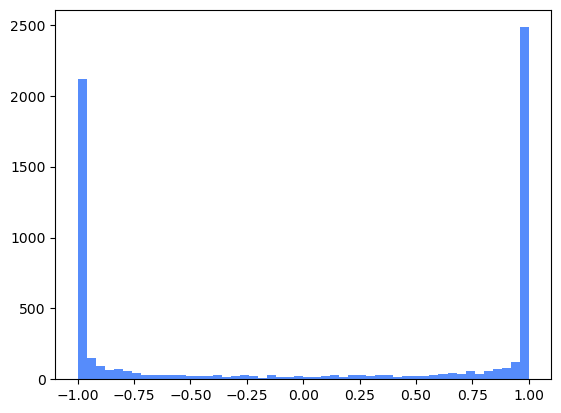
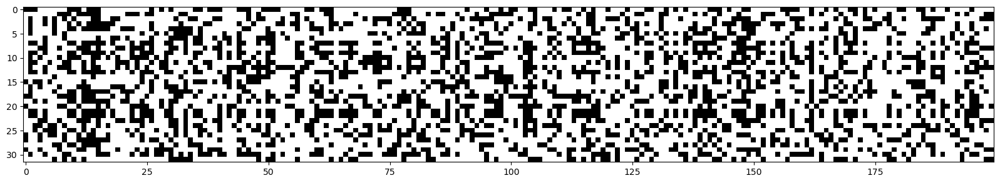
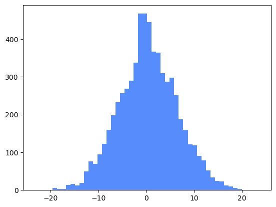
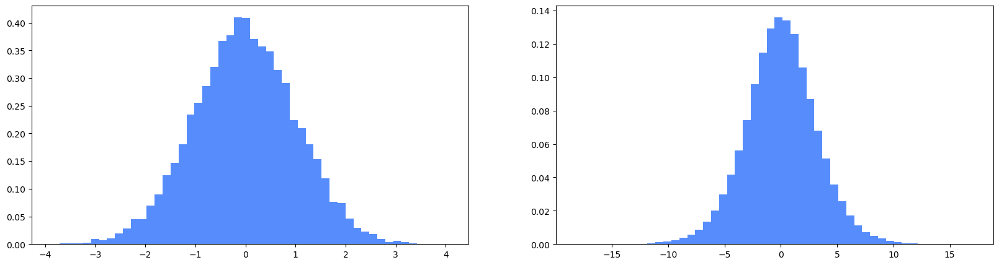
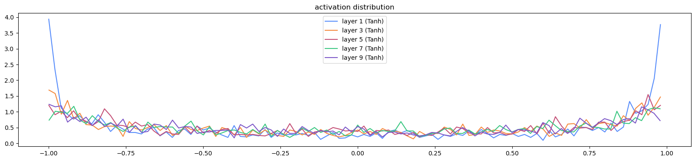
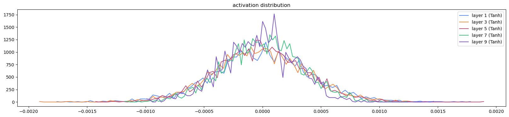
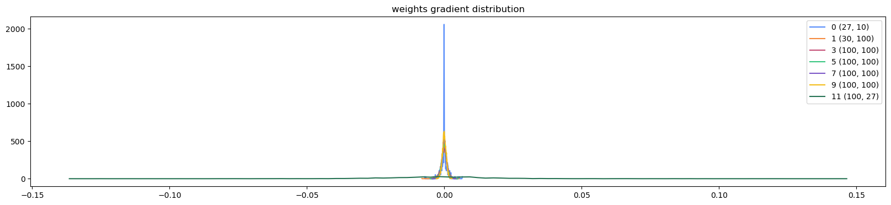
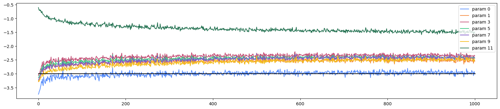

# P4

## 4.1 回顾

延续上一节课：

```
import torch
import torch.nn.functional as F
import  matplotlib.pyplot as plt
import os
os.environ['KMP_DUPLICATE_LIB_OK']='TRUE'
%matplotlib inline
```

```
words = open('names.txt','r').read().splitlines()
```

```
chars = sorted(list(set(''.join(words))))
stoi = {s: i+1 for i, s in enumerate(chars)}
stoi['.'] = 0
itos = {i:s for s, i in stoi.items()}
vocab_size = len(itos)
```

```
block_size = 3#上下文为3，输入3个字符预测下一个字符。
def build_dataset(words):
    # context length: how many characters do we take to predict the next one?
    X, Y = [], []

    for w in words:
        # print(w)
        context = [0] * block_size
        for ch in w + '.':
            ix = stoi[ch]
            X.append(context)
            Y.append(ix)
            # print(''.join(itos[i] for i in context), '-->', itos[ix])
            context = context[1:] + [ix]  # crop and append

    X = torch.tensor(X)
    Y = torch.tensor(Y)
    print(X.shape, Y.shape)

    return X, Y


import random

random.seed(42)
random.shuffle(words)

n1 = int(0.8 * len(words))
n2 = int(0.9 * len(words))

Xtr, Ytr = build_dataset(words[:n1])
Xdev, Ydev = build_dataset(words[n1:n2])
Xte, Yte = build_dataset(words[n2:])
```

```
# MLP revisited
n_embd = 10  #输入样本的每一个字符映射成多少维度的嵌入向量，此处为10。
n_hidden = 200  #表示隐藏层有多少个神经元。

g = torch.Generator().manual_seed(2147483647)
C = torch.randn((vocab_size, n_embd), generator=g)
W1 = torch.randn((n_embd * block_size, n_hidden), generator=g)
b1 = torch.randn(n_hidden, generator=g)
W2 = torch.randn((n_hidden, vocab_size), generator=g) * 0.1
b2 = torch.randn(vocab_size, generator=g) * 0
#刚开始的损失函数图像可能呈现棒球状，开始起伏很大的过程其实是模型压缩逻辑值的过程，后面才是调整逻辑值的过程
#乘以0.1和加上0会帮助我们从一开始就避免那个过程的发生。
parameters = [C, W1, b1, W2, b2]
print(sum(p.nelement() for p in parameters))
for p in parameters:
    p.requires_grad = True
```

```
# same optimization as last time
max_steps = 200000#循环多少次，也就是进行多少论训练。
batch_size = 32#每个批次包含多少个样本
lossi = []

for i in range(max_steps):

    # minibatch construct
    ix = torch.randint(0, Xtr.shape[0], (batch_size,), generator=g)#Xtr.shape[0]表示待训练样本的总数量
    Xb, Yb = Xtr[ix], Ytr[ix]#将此次随机到的数据赋给对应变量

    # forward pass
    emb = C[Xb]  # 形状为（32，3，10）
    embcat = emb.view(emb.shape[0], -1) #需要将一次输入的样本拼接起来，按照这段代码，一次性的32个样本。
    #另一维度应该为30。
    hpreact = embcat @ W1 + b1  # hidden layer pre-activation
    h = torch.tanh(hpreact)  # hidden layer
    logits = h @ W2 + b2  # output layer
    loss = F.cross_entropy(logits, Yb)  # 损失函数

    # backward pass
    for p in parameters:
        p.grad = None
    loss.backward()

    # update
    lr = 0.1 if i < 100000 else 0.01  # step learning rate decay
    for p in parameters:
        p.data += -lr * p.grad

    # track stats
    if i % 10000 == 0:  # print every once in a while
        print(f'{i:7d}/{max_steps:7d}: {loss.item():.4f}')
    lossi.append(loss.log10().item())
```

```
@torch.no_grad()  # this decorator disables gradient tracking
def split_loss(split):
    x, y = {
        'train': (Xtr, Ytr),
        'val': (Xdev, Ydev),
        'test': (Xte, Yte),
    }[split]

    emb = C[x]  # (N, block_size, n_embd)
    embcat = emb.view(emb.shape[0], -1)  # concat into (N, block_size * n_embd)
    h = torch.tanh(embcat @ W1 + b1)  # (N, n_hidden)
    logits = h @ W2 + b2  # (N, vocab_size)
    loss = F.cross_entropy(logits, y)
    print(split, loss.item())

split_loss('train')
split_loss('val')
```

```
# sample from the model
g = torch.Generator().manual_seed(2147483647 + 10)

for _ in range(20):

    out = []#预测结果的列表
    context = [0] * block_size  #上下文，初始化为[0,0,0]。也就是从...开始预测。
    while True:#执行循环，直到预测的下一个字符为结束符.为止，就可以跳出循环了。
    #forward pass the neural net
        emb = C[torch.tensor([context])]  #以[0,0,0]为例，会取出[C[0],C[0],C[0]],也就是（1，3，10）。
        # (1,block_size,n_embd)
        h = torch.tanh(emb.view(1, -1) @ W1 + b1)
        logits = h @ W2 + b2
        probs = F.softmax(logits, dim=1)
        # sample from the distribution
        ix = torch.multinomial(probs, num_samples=1, generator=g).item()
        # shift the context window and track the samples
        context = context[1:] + [ix]
        out.append(ix)
        # if we sample the special '.' token, break
        if ix == 0:
            break

    print(''.join(itos[i] for i in out))
```

##  4.2 如何初始化神经网络？

```
plt.plot(lossi)
```

绘制图像如下:


**【为什么要使用loss.log10().item()？而不直接使用loss.item()？**

**取log10()并没有改变损失函数的相对大小，由于训练过程中损失函数可能跨越不同数量级，为了方便绘制曲线和观察损失的相对变化，可以对 Loss 取以 10 为底的对数。可以理解为压缩数据范围。】**

每次相隔10000次记录一下损失函数的对数。可以看到开始的几轮损失函数对数值仍然很大。

刚开始模型没有经过训练，我们希望模型初始化时不要对某个字符有过强的偏向。

理想状态下：`-(1/27).log()`为3.2958，也就是初始几轮的损失函数值应该接近3.2958，取对数后应该接近 0.518。

再思考这个问题之前，先来看一段代码：

```
# 4-dimensional example of the issue
logits = torch.tensor([0.0, 0.0, 0.0, 0.0])#假设某个模型输出层输出4个0。
probs = torch.softmax(logits, dim=0)#经过激活函数softmax。
loss = -probs[2].log()#假设正确标签为2，所以此时求2的负对数似然
probs, loss
#如果初始值相差过大，会导致损失函数过大。因此我们希望初始的时候，输出的logits之间的差距不要过大。
```

如果某个模型输出层输出4个0，正确标签为2，求对应结果的负对数似然，为1.3863。

但是我们调整`logits = torch.tensor([-5.0, 0.0, 0.0, 5.0])`，此时结果为5.0134，差不多是之前的五倍。

由于模型在初始化时还没有学习到数据中的规律，我们希望它的预测概率相对均匀，而不是随机地偏向某个类别，我们希望模型初始的逻辑值要比较接近。

回看代码：`logits = h @ W2 + b2`

我们希望logits的值接近0，因此W2和b2要尽可能小。

```
W2 = torch.randn((n_hidden, vocab_size), generator=g) * 0.1
b2 = torch.randn(vocab_size, generator=g) * 0
```

如上可以将W1和b2对h的影响降低，可以运行代码看到第一个10000轮过后，损失函数变小。

**【为什么W2的后面不乘以0？】**

看起来似乎没有问题，但是当我们查看h的值时会发现：

```
h.shape
plt.hist(h.view(-1).tolist(),50);
```



发现很多 `h` 的值集中在 `-1` 和 `1` 附近。

这说明虽然通过缩小 `W2` 和令 `b2=0` 改善了输出层 `logits` 的分布，但隐藏层本身的输出分布仍然非常极端。

```
def tanh(self):
    x = self.data
    t = (math.exp(2*x)-1)/(math.exp(2*x)+1)
    out = Value(t, (self, ))
    def _backward():
        self.grad += (1-t**2) * out.grad
     out._backward = _backward
     return out
```

由于：
$$
h = \tanh(hpreact)
$$
如果很多 `h` 接近 `-1` 或 `1`，说明很多 `hpreact` 的绝对值已经较大，落入了 `tanh` 的饱和区。

在反向传播时，根据链式法则：
$$
 \frac{\partial L}{\partial hpreact} = \frac{\partial L}{\partial h}\cdot(1-h^2) 
$$
而 `tanh` 的导数为：
$$
\frac{d}{dx}\tanh(x)=1-\tanh^2(x)
$$
因此，当
$$
h\approx \pm1
$$
 时，
$$
1-h^2 \approx 0
$$
于是：
$$
\frac{\partial L}{\partial hpreact}\approx 0
$$
这意味着梯度在经过 `tanh` 时会被大幅衰减，甚至接近消失，从而使得更前面的参数（如 `W1`、`b1` 和嵌入矩阵 `C`）难以得到有效更新。

这也说明，当 `tanh` 输入过大或过小时，激活函数进入平坦区，此时即使继续改变输入，输出变化也很小，因此损失函数对这些输入不再敏感。

如果 `tanh` 的输出接近 0，则：
$$
1-h^2 \approx 1
$$
说明此时梯度几乎可以无衰减地通过该层。

因此，通过 `tanh` 的梯度只会衰减，其衰减程度与：
$$
1-h^2
$$
成正比。

利用如下代码生成灰度图，h.shape=（32，200），32个样本经过隐藏层的输出，每个样本输出（200，）的张量。白色部分为绝对值大于0.99。

```
plt.figure(figsize=(20,10))
plt.imshow(h.abs()>0.99,cmap='gray',interpolation='nearest')
```



图表中的每一列表示不同样本通过不同神经元的输出结果，如果有某一列全部为白色，表示经过该神经元的全部输出为0。这个神经元的输入权重和偏置难以收到有效的梯度，可能导致这个神经元学习缓慢，甚至长期失去有效学习能力。

因此我们需要关注hpreact：

```
plt.hist(hpreact.view(-1).tolist(),50);
```



观察hpreact。在神经网络里面只要输入绝对值达到3以上，输出就会非常饱和。

图像中大量数据超过该绝对值，进入激活函数的平坦区域。

继续回溯发现：

```
emb = C[Xb]  # 形状为（32，3，10）
embcat = emb.view(emb.shape[0], -1)
hpreact = embcat @ W1 + b1
```

我们希望hpreact的值能靠近0，可以进行类似处理。

```
W1 = torch.randn((n_embd * block_size, n_hidden), generator=g)* 0.1
b1 = torch.randn(n_hidden, generator=g) *0.01
```

总结一下：我们发现前几轮的损失函数值非常大，因此查看logits，发现不同值的差距有点大。因此调整w2和b2，减少他们对最终logits的影响。但是我们又发现h的分布本身就很极端，由于`h = torch.tanh(hpreact)`，自然想到改善hpreact。hpreact的值可以通过调整w1和b1的值进行。调整 `W2`、`b2` 是为了解决输出层初始化不合理的问题，而调整 `W1`、`b1` 是为了解决隐藏层 `tanh` 饱和、梯度衰减的问题。两者的目的有所不同。

## 4.3 怎么设置参数的放缩系数？

```
x = torch.randn(1000, 10)
w = torch.randn(10, 200) / 10**0.5
y = x @ w

print(x.mean(), x.std())
print(y.mean(), y.std())

plt.figure(figsize=(20, 5))
plt.subplot(121)
plt.hist(x.view(-1).tolist(), 50, density=True)
plt.subplot(122)
plt.hist(y.view(-1).tolist(), 50, density=True)
```



观察输出以及图像会发现，输入和输出的均值都接近0，但是输入的标准差接近1，输出的标准差接近3。说明数据在扩张。

w乘以一个较大的值，会发现扩张幅度更大，乘以一个较小的值，会发现基本不会扩张。

**我们要乘以多大的值才能使得输出的标准差仍然接近1？**

答案是每个输入神经元的权重数量的平方根。【扇入数（Fan-in）指的是一个神经元接收的输入数量。】

幸运的是，可以直接通过查询pytorch文档，找到缩放系数。本次激活函数为tanh，缩放系数为`(5/3)/(n_embd * block_size)**0.5`

## 4.4 批量归一化

我们不希望hpreact太小，否则它激活不了神经元，tanh也起不了作用。我们也不希望它太大，否则tanh会进入饱和区。

我们希望hpreact符合高斯分布，均值为0，标准差为1。

这里的对象为每一列。

```
hpreact.mean(0, keepdim=True)
hpreact.std(0, keepdim=True)
hpreact = (hpreact - hpreact.mean(0, keepdim=True) )/hpreact.std(0, keepdim=True)
```

这样做后，初始时，每个神经元接收的数据基本符合高斯分布，有利于训练。

但是也带来一个问题，我们不希望之后的训练过程中，每个神经元的输入分布仍然被强制要求。

基于此，我们引入增益系数和偏置。

```
bngain = torch.ones((1,n_hidden))
bnias = torch.zero((1,n_hidden))
```

相应的：

```
hpreact = bngain*(hpreact - hpreact.mean(0, keepdim=True) )/hpreact.std(0, keepdim=True)+bnias
```

并将它们加入更新的参数中，这样也能随着训练逐渐更新。

之前对 W1 进行初始化缩放，是为了让神经网络在训练开始时具有合适的激活值分布，避免 `tanh` 饱和。但是随着训练进行，权重会不断变化，初始的缩放系数无法保证后续激活值的尺度始终合适。对于更深的 MLP，各层的激活值尺度也更难仅靠初始化来控制。因此可以引入 Batch Normalization，在训练过程中持续进行标准化，从而改善优化条件和训练稳定性。

但是……

样本之间本来具有独立性，使用归一化后，会将他们耦合在一起。Batch Normalization 为了估计每个神经元的激活值分布，使用同一个 batch 中多个样本的统计量进行归一化。虽然这些样本原本相互独立，但归一化后的结果会产生依赖关系。

不过换一种角度，Batch Normalization 由于引入了 mini-batch 统计量的随机性，因此具有一定的隐式正则化效果。也就是相当于多了一个正则化项。

## 4.5 怎么输入单个样本？

当我们完成神经网络的训练，我们希望将它部署到应用中。用户输入单个样本，能够得到预测结果。

但是，怎么才能输入单个样本？

```
# calibrate the batch norm at the end of training
with torch.no_grad():
    # pass the training set through
    emb = C[Xtr]#得到嵌入词表
    embcat = emb.view(emb.shape[0], -1)
    hpreact = embcat @ W1 + b1
    # measure the mean/std over the entire training set
    bnmean = hpreact.mean(0, keepdim=True)
    bnstd = hpreact.std(0, keepdim=True)
```

由于 Batch Normalization 在训练过程中使用当前 mini-batch 的均值和标准差，因此样本之间存在一定的耦合。

在预测阶段，我们希望每个样本能够独立进行预测，因此不能继续依赖当前 batch 的统计量。

为了解决这个问题，Karpathy 在训练结束后，使用训练完成的模型重新计算整个训练集的 `hpreact`，得到每个神经元的均值 `bnmean` 和标准差 `bnstd`。

之后预测时直接使用这两个固定的统计量进行归一化。

这样仍然有些麻烦，我们还有另一种方法。

```
bnmeani = hpreact.mean(0, keepdim=True)
bnstdi = hpreact.std(0, keepdim=True)
hpreact = bngain*(hpreact - bnmeani )/bnstdi+bnias
```

维持两个变量bnmeani和bnstdi，分别是hpreact每一列训练过程中的均值和标准差。

```
bnmean_running = torch.zeros((1,n_hidden))
bnstd_running = torch.ones((1,n_hidden))
```

我们还设置了两个变量bnmean_running和bnstd_running，他们是最终用于预测时候的均值和标准差。

```
with torch.no_grad():
    bnmean_running = 0.999 * bnmean_running + 0.001 * bnmeani
    bnstd_running = 0.999 * bnstd_running + 0.001 * bnstdi
```

每次都进行小幅度更新，避免受到每个批次的变化而剧烈波动。

```
hpreact = embcat @ W1 + b1  *# hidden layer pre-activation*\
bnmeani = hpreact.mean(0, keepdim=True)\
bnstdi = hpreact.std(0, keepdim=True)\
hpreact = bngain\*(hpreact - bnmeani )/bnstdi+bnias
```

观察这一段代码，我们计算hpreact时，会加上偏置b1。但之后计算过程中又会被抵消掉。

【b1广播的时候，同一列也就是同一个神经元，所加的偏置是相同的。假设某一个神经元，每一个输入进来的样本都加上b，求均值的时候相当于原来的均值加上b。

用hpreact-hpreact.mean(0,keepdim=True)，每一列又相当于减去b，所以其实没有变化。】

所以加上b1其实没有多少意义。

【P4，1：14：00左右，karpathy有对上面内容的总结】

## 4.6额外补充，pytorch重新实现上述功能

```
# Let's train a deeper network

class Linear:#线性层

    def __init__(self, fan_in, fan_out, bias=True):#输入特征数、输出特征数、是否使用偏置项
        self.weight = torch.randn((fan_in, fan_out), generator=g) / fan_in**0.5
        self.bias = torch.zeros(fan_out) if bias else None

    def __call__(self, x):
        self.out = x @ self.weight
        if self.bias is not None:
            self.out += self.bias
        return self.out

    def parameters(self):
        return [self.weight] + ([] if self.bias is None else [self.bias])


class BatchNorm1d:#批量归一化层

    def __init__(self, dim, eps=1e-5, momentum=0.1):#eps用于极小值运算，momentum用于追踪滑动均值和滑动方差的动量值
        self.eps = eps
        self.momentum = momentum
        self.training = True#是使用训练模式还是评估模式，训练模式会使用当前批次的均值和标准差，如果是评估模式，则会使用滑动均值和滑动标准差

        # parameters (trained with backprop)
        self.gamma = torch.ones(dim)
        self.beta = torch.zeros(dim)

        # buffers (trained with a running 'momentum update')
        self.running_mean = torch.zeros(dim)
        self.running_var = torch.ones(dim)

    def __call__(self, x):
        # calculate the forward pass
        if self.training:
            xmean = x.mean(0, keepdim=True)  # batch mean
            xvar = x.var(0, keepdim=True, unbiased=True)  # batch variance
        else:
            xmean = self.running_mean
            xvar = self.running_var

        xhat = (x - xmean) / torch.sqrt(xvar + self.eps)  # normalize to unit variance
        self.out = self.gamma * xhat + self.beta

        # update the buffers
        if self.training:
            with torch.no_grad():
                self.running_mean = (1 - self.momentum) * self.running_mean + self.momentum * xmean
                self.running_var = (1 - self.momentum) * self.running_var + self.momentum * xvar

        return self.out


class Tanh:
    def __call__(self, x):
        self.out = torch.tanh(x)
        return self.out

    def parameters(self):
        return []
```

定义神经网络结构，主要有线性层、激活函数、批量归一化层组成。

```
n_embd = 10  #每个字符对应的嵌入向量维度
n_hidden = 100  #隐藏层神经元数量，这里每个隐藏层均为100个
g = torch.Generator().manual_seed(2147483647)  # for reproducibility

C = torch.randn((vocab_size, n_embd), generator=g) #创建字符嵌入矩阵，每个字符对应一个随机初始化的10维向量

layers = [
    Linear(n_embd * block_size, n_hidden), Tanh(),
    Linear(             n_hidden, n_hidden), Tanh(),
    Linear(             n_hidden, n_hidden), Tanh(),
    Linear(             n_hidden, n_hidden), Tanh(),
    Linear(             n_hidden, n_hidden), Tanh(),
    Linear(             n_hidden, vocab_size),
]

with torch.no_grad():
    # last layer: make less confident
    layers[-1].weight *= 0.1#缩小初始 logits 的差异，避免初始预测过度自信

    # all other layers: apply gain
    for layer in layers[:-1]:
        if isinstance(layer, Linear):
            layer.weight *= 5/3#增益系数，之前Linear已经缩放过了，补偿 tanh 的信号压缩，帮助维持合理的激活尺度

parameters = [C] + [p for layer in layers for p in layer.parameters()]
print(sum(p.nelement() for p in parameters))  # number of parameters in total

for p in parameters:
    p.requires_grad = True
```

定义训练过程，向前传播、反向传播、更新梯度。

```
# visualize histograms
plt.figure(figsize=(20, 4))#创建画布，宽为20，高为4。
legends = []#创建空列表，用来保存每条曲线的图例名称。

for i, layer in enumerate(layers[:-1]):#遍历除了最后输出层以外的其他层，遍历列表时，同时返回元素索引和元素本身。
    if isinstance(layer, Tanh):#判断layer是否为Tanh的实例。
        t = layer.out#当前 Tanh 层在最近一次前向传播中产生的输出。
        print('layer %d (%10s): mean %+.2f, std %.2f, saturated: %.2f%%' %
              (i, layer.__class__.__name__, t.mean(), t.std(),
               (t.abs() > 0.97).float().mean() * 100))#饱和百分比，可以理解为位于饱和区的数据占整体数据的比例

        hy, hx = torch.histogram(t, density=True)
        plt.plot(hx[:-1].detach(), hy.detach())
        legends.append(f'layer {i} ({layer.__class__.__name__})')

plt.legend(legends)
plt.title('activation distribution')
```

绘制图像，横坐标为Tanh 的输出值，取值范围为 \((-1,1)\)。代码将这些值划分成若干区间。纵坐标为落在对应区间内的概率密度，而不是直接的概率。
$$
\boxed{\text{区间概率}\approx\text{概率密度}\times\text{区间宽度}}
$$
可以简单理解为聚集在某一点附近的密度，可以判断激活值是否过度集中、是否出现大量饱和现象。

图像如下：



这张图是在检查前向传播的激活值分布，而我们希望借此判断 Tanh 是否过度饱和。可以看到，第一个tanh的输出两边有很多值落在饱和区，后面几层明显有减缓。

```
# visualize histograms
plt.figure(figsize=(20, 4))#创建画布，宽为20，高为4。
legends = []#创建空列表，用来保存每条曲线的图例名称。

for i, layer in enumerate(layers[:-1]):#遍历除了最后输出层以外的其他层，遍历列表时，同时返回元素索引和元素本身。
    if isinstance(layer, Tanh):#判断layer是否为Tanh的实例。
        t = layer.out.grad#当前 Tanh 层在最近一次前向传播中产生的输出。
        print('layer %d (%10s): mean %+.2f, std %.2f, saturated: %.2f%%' %
              (i, layer.__class__.__name__, t.mean(), t.std(),
               (t.abs() > 0.97).float().mean() * 100))#饱和百分比，可以理解为位于饱和区的数据占整体数据的比例

        hy, hx = torch.histogram(t, density=True)
        plt.plot(hx[:-1].detach(), hy.detach())
        legends.append(f'layer {i} ({layer.__class__.__name__})')

plt.legend(legends)
plt.title('activation distribution')
```



如图为梯度，可以看到各层输出梯度的数值尺度看起来比较接近，没有明显的层间梯度尺度失衡。

我们希望tanh的输出值分布合理，这样才能充分发挥激活函数的作用。否则聚集在饱和区，会使得梯度传播衰减严重。【不要弄混了，之前是让hpreact符合正态分布，而对tanh的输出是分布合理即可。】

**我们之前是想让hpreact符合正态分布，tanh输出分布合理即可。除以fan_in\*\*0.5是想让标准差保持在1附近，乘以\(5/3\)是因为tanh输出会压缩，所以需要增益系数抵消。**

tanh的梯度分布最好一致，这表明梯度既没有衰减，也没有爆炸。

**为什么要引入tanh层？**

**如果只是线性层的叠加，不管有多少个线性层，最后都会坍塌成一个线性变换，因此需要引入非线性函数。**

```
# visualize histograms
plt.figure(figsize=(20, 4))  # width and height of the plot
legends = []

for i, p in enumerate(parameters):
    t = p.grad
    if p.ndim == 2:
        print('weight %10s | mean %+f | std %e | grad:data ratio %e' %
              (tuple(p.shape), t.mean(), t.std(), t.std() / p.std()))

        hy, hx = torch.histogram(t, density=True)
        plt.plot(hx[:-1].detach(), hy.detach())
        legends.append(f'{i} {tuple(p.shape)}')

plt.legend(legends)
plt.title('weights gradient distribution');
```



grad:data ratio是比较梯度和参数自身的尺度。

```
ud = []
with torch.no_grad():
    ud.append([(lr*p.grad.std() / p.data.std()).log10().item() for p in parameters if p.requires_grad])

plt.figure(figsize=(20, 4))
legends = []

for i, p in enumerate(parameters):
    if p.ndim == 2:
        plt.plot([ud[j][i] for j in range(len(ud))])
        legends.append('param %d' % i)

plt.plot([0, len(ud)], [-3, -3], 'k')  # these ratios should be ~1e-3, indicate on plot
plt.legend(legends);
```



观察到最后输出层的更新幅度明显，这是因为乘以 \(0.1\) 缩小了输出层权重，降低了分母；而输出层的梯度没有同比例缩小，因此相对更新幅度变大。这是输出层在 `ud` 图中表现突出的重要原因。

## 总结

### 第一步：发现初始损失函数过高。

我们发现模型前几轮的损失函数值非常高，于是检查输出层的 `logits`，发现不同类别的 `logits` 之间差异过大，可能导致模型对某些类别过度自信，从而使损失函数过高。

因此，我们希望改善 `logits` 的分布。

### 第二步：缩小输出层权重的影响。

根据：

```
logits = h @ W2 + b2
```

我们尝试将输出层的权重和偏置进行缩放，减小它们对最终 `logits` 的影响，使初始输出的差异不要太大，从而降低初始损失函数。

### 第三步：发现隐藏层激活值也存在问题。

我们继续观察：

```
h = torch.tanh(embcat @ W1 + b1)
```

发现 `h` 的很多值集中在 \(-1\) 和 \(1\) 附近，说明大量激活值进入了 Tanh 的饱和区域，可能导致反向传播时梯度衰减。

因此，我们希望改善 Tanh 的输入，也就是 `hpreact` 的分布。

### 第四步：调整隐藏层的权重初始化。

根据：

```
hpreact = embcat @ W1 + b1
```

我们尝试调整 `W1` 和 `b1`，改变 `hpreact` 的数值分布，避免过多的输入进入 Tanh 的饱和区域。

后来，我们发现，采用与输入维度有关的缩放系数：
$$
\frac{1}{\sqrt{fan\_in}}
$$
能够取得比较好的效果，因此在权重初始化时使用这个系数。

### 第五步：乘以增益系数 \(5/3\)，补偿 Tanh 对信号尺度的影响。

由于 Tanh 是一种非线性激活函数，它会压缩输入信号，尤其是输入较大时，输出会逐渐趋近于 \(-1\) 或 \(1\)。

因此，在权重已经按照 \(1/\sqrt{fan\_in}\) 缩放的基础上，我们进一步将隐藏层的权重乘以增益系数：
$$
\boxed{\text{gain}=\frac{5}{3}}
$$

这样做是为了补偿 Tanh 对信号传播造成的影响，帮助深层网络维持合理的激活值尺度，改善梯度传播。

需要注意，\(5/3\) 是一种针对 Tanh 的常用初始化增益，并不能保证每一层的输出标准差都恰好等于 1。

### 第六步：引入批量归一化（Batch Normalization），在训练过程中动态控制数据的数值尺度。

之前的权重初始化只能在训练开始前控制数据的数值尺度。随着训练进行，权重不断更新，每一层的 `hpreact` 分布也会发生变化，因此仅靠初始化无法保证训练过程中数据始终保持合理的范围。

为了解决这个问题，我们在线性层和激活函数之间加入批量归一化层，利用下面的公式调整 `hpreact` 的分布：
$$
boxed{ hpreact=bngain\cdot \frac{hpreact-bnmeani}{bnstdi} +bnias } 
$$
其中，`bnmeani` 和 `bnstdi` 分别表示当前批次中每个神经元输入的均值和标准差；`bngain` 和 `bnias`（偏置参数）则用于进一步调整归一化后的数据。

这样就能在训练过程中持续调整每一层的数据分布，使其保持合理的数值尺度，减少 Tanh 进入饱和区域的情况。

不过，这种操作也会带来一个特点：原本相互独立的样本，会因为共同使用当前批次的均值和标准差而产生耦合。 这种由批次统计量引入的随机性具有一定的正则化效果，可能有利于模型的泛化能力。

因此，批量归一化既能帮助控制训练过程中的数据分布，也可能带来一定的正则化收益。